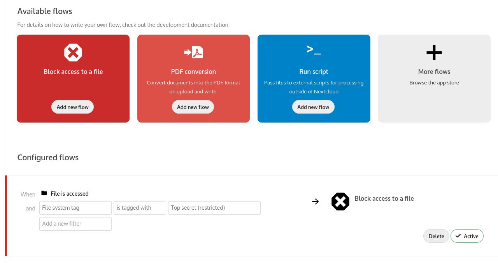

<!--
  - SPDX-FileCopyrightText: 2016 Nextcloud GmbH and Nextcloud contributors
  - SPDX-License-Identifier: AGPL-3.0-or-later
-->
# File access control for Nextcloud Flow

The File access control app adds a **Block access to a file** operation to Nextcloud Flow, allowing administrators to restrict access based on configured rules. This enables administrators to protect data from unauthorized access or modifications.

## How it works

Administrators can create and manage rule groups in the Flow settings. Each group contains one or more rules. Rules within a group are combined with AND: the group matches only when all its rules match. If any rule group matches, access is denied or the upload is blocked. Criteria include IP address, MIME type, request time, user group membership, collaborative tags, and user agent.

For example, an administrator could deny access from outside the internal network to Excel/XLSX files marked with a "Human Resources" collaborative tag. Another rule group could block uploads above a configured size limit by members of the "1st year" group. The file-size criterion is available only for uploads.

Use restricted or invisible tags for access control so users cannot remove a tag to bypass a rule.

## Limitations

* These rules govern access through Nextcloud; they do not prevent direct access to an external storage system.
* Context Chat is not affected by File Access Control rules and may return indexed information from files a user cannot access through Nextcloud.
* A rule based on user group membership may not match an unauthenticated visitor accessing a public link.

See the documentation for these and other configuration considerations.

Learn more about File Access Control on [https://nextcloud.com/workflow](https://nextcloud.com/workflow) and in the [Files access control documentation](https://docs.nextcloud.com/server/stable/go.php?to=admin-files-access-control).

